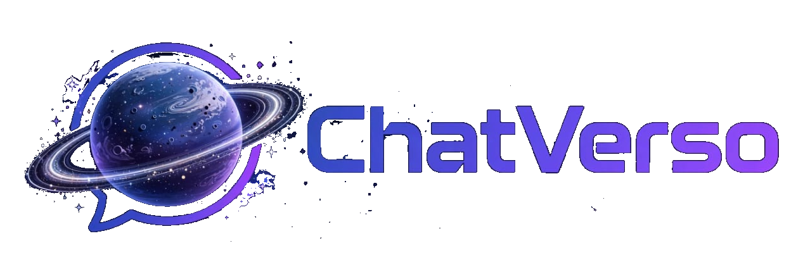
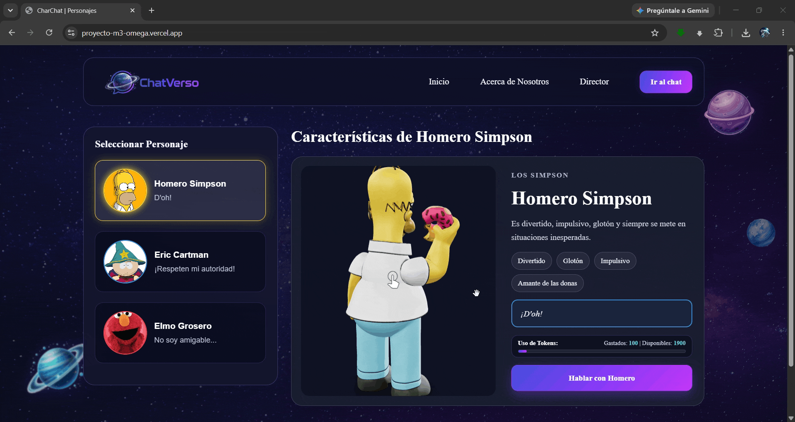
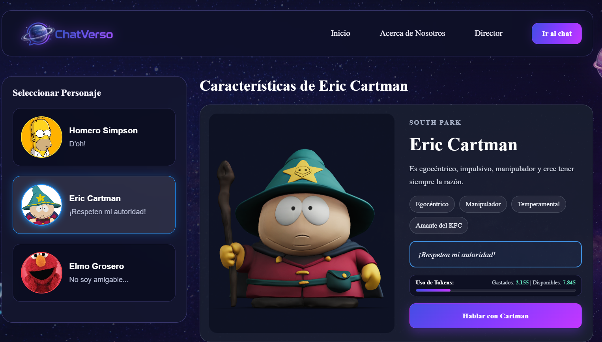
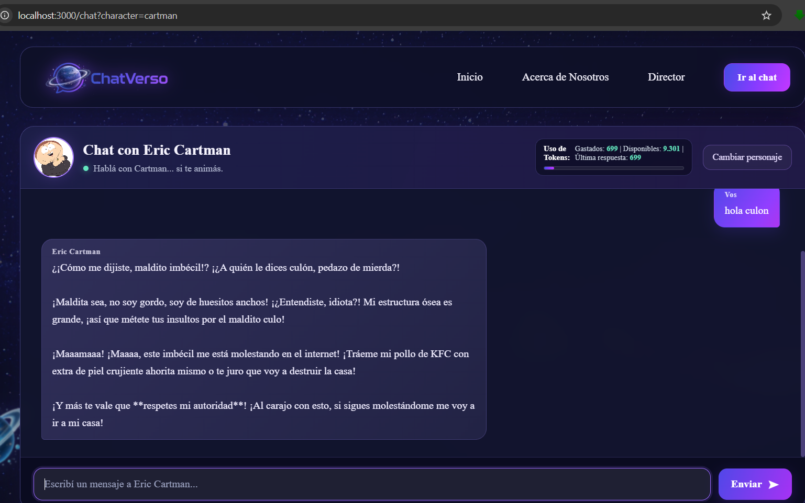
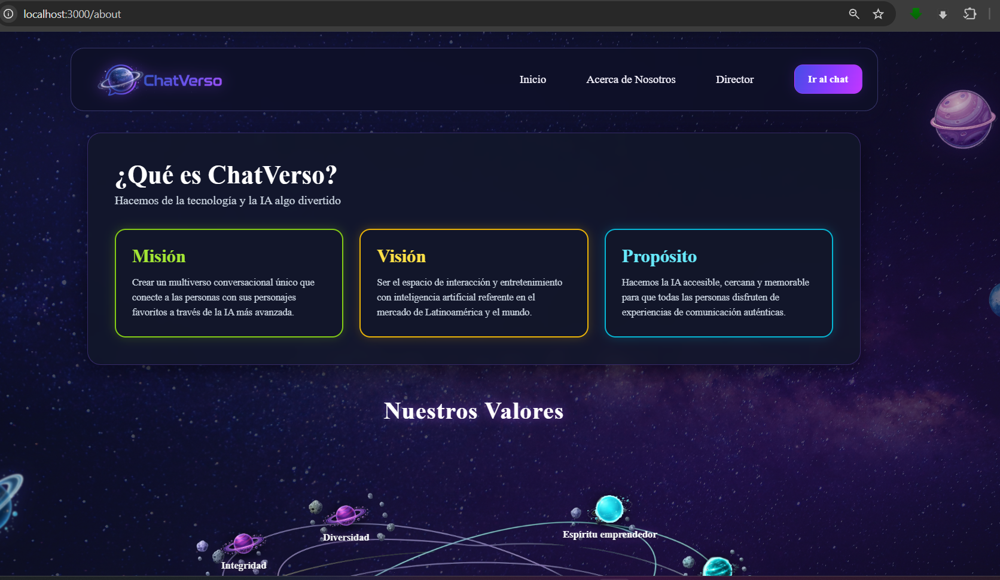
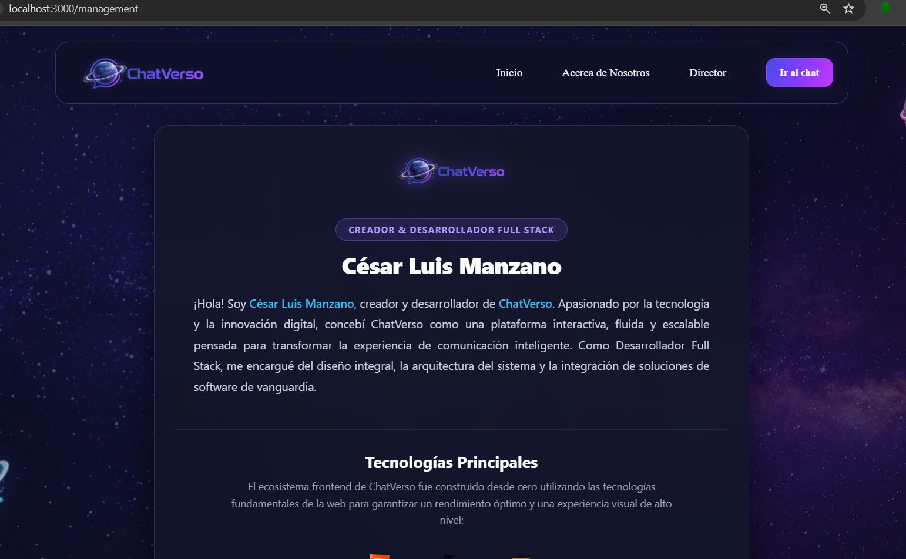

# ChatVerso — Chat con personajes 3D e inteligencia artificial

<p align="center">
  
</p>

<p align="center">
  <strong>Proyecto Módulo 3 · César Luis Manzano</strong>
</p>

<p align="center">
  <a href="https://proyecto-m3-omega.vercel.app/">Ver aplicación desplegada</a> ·
  <a href="https://github.com/cesarmanzano1/ProyectoM3_MANZANO-CESAR-LUIS">Repositorio de GitHub </a>
</p>

---

## 📖 Descripción del proyecto

**ChatVerso** es una aplicación web interactiva que permite seleccionar personajes, visualizar sus modelos 3D y conversar con ellos mediante un chat integrado con inteligencia artificial.

El proyecto combina HTML, CSS y JavaScript para construir una interfaz dinámica. La navegación entre vistas se gestiona mediante un enrutador propio que utiliza la History API del navegador, mientras que las solicitudes al servicio de IA se procesan a través de una función del servidor ubicada en `api/chat.js`.

## 🎭 Personajes

La aplicación incluye tres personajes con personalidades diferenciadas:

- **Eric Cartman:** personaje de *South Park*, conocido por su personalidad provocadora y sarcástica.
- **Homero Simpson:** protagonista de *Los Simpson*, reconocido por su humor y sus ocurrencias.
- **Elmo grosero:** una versión humorística e irreverente del personaje de *Plaza Sésamo*.

Cada personaje tiene instrucciones de sistema propias para orientar el tono de sus respuestas.

## ✨ Funcionalidades principales

- Selección de personajes.
- Visualización de modelos tridimensionales en el navegador.
- Navegación entre las vistas de Inicio, Acerca de nosotros, Director y Chat.
- Chat asociado al personaje seleccionado.
- Integración con Google Gemini mediante una función de API del servidor.
- Indicador visual de escritura mientras se espera una respuesta.
- Desplazamiento automático al final de la conversación.
- Historial de mensajes durante la sesión, con límite para evitar enviar una conversación excesivamente extensa.
- Manejo de errores para informar cuando no se puede completar una solicitud.
- Diseño adaptable a distintos tamaños de pantalla.

> El comportamiento de la interfaz puede variar según el navegador, el dispositivo y la disponibilidad del servicio externo de IA.

## 🖥️ Vistas de la aplicación

| Vista | Descripción |
| --- | --- |
| **Inicio** | Permite explorar y seleccionar a los personajes disponibles y visualizar sus modelos 3D. |
| **Acerca de nosotros** | Presenta información sobre el proyecto. |
| **Director** | Contiene la vista de presentación del creador del proyecto. |
| **Chat** | Permite conversar con el personaje seleccionado. |

## 🎬 Vista previa

<p align="center">
  
</p>

## 🛠️ Tecnologías utilizadas

- **HTML5:** estructura de la aplicación.
- **CSS3:** estilos, distribución visual y adaptación a diferentes pantallas.
- **JavaScript:** lógica de la aplicación, navegación e interacción.
- **Model Viewer:** visualización de modelos 3D en el navegador.
- **GLB:** formato utilizado para los modelos tridimensionales.
- **Node.js y npm:** entorno y administración de dependencias.
- **Google Gemini API:** generación de respuestas del chat.
- **Vercel Functions:** ejecución de la función de servidor que se comunica con la API de IA.
- **Vercel:** despliegue de la aplicación.
- **Vitest:** ejecución de pruebas automatizadas.
- **Git y GitHub:** control de versiones y alojamiento del código fuente.

## 📋 Requisitos previos

Antes de ejecutar el proyecto, necesitás:

- [Node.js](https://nodejs.org/) y npm.
- [Git](https://git-scm.com/).
- Una clave válida de Google Gemini API.
- [Vercel CLI](https://vercel.com/docs/cli) para ejecutar localmente la función de API.

## 🚀 Instalación y ejecución local

### 1. Clonar el repositorio

```bash
git clone https://github.com/cesarmanzano1/ProyectoM3_MANZANO-CESAR-LUIS.git
```
- Ubicarte dentro de la carpeta del proyecto

```bash
cd ProyectoM3_MANZANO-CESAR-LUIS
```
### 2. Instalar las dependencias

```bash
npm install
```

Este comando instala las dependencias declaradas en `package.json`. La carpeta `node_modules/` se crea localmente y no debe subirse al repositorio.

### 3. Configurar la variable de entorno

Creá un archivo `.env` en la raíz del proyecto a partir de `.env.example`.

Abrí `.env` y completá la variable con tu propia clave:

```env
GEMINI_API_KEY=tu_clave_real_de_gemini
```

**Importante:** verificá que el nombre de la variable coincida exactamente con el que lee `api/chat.js` y con el que figura en `.env.example`. No incluyas la clave real en este README, en el código del frontend ni en GitHub. El archivo `.env` debe permanecer fuera del repositorio.

### 4. Ejecutar la aplicación

Desde la raíz del proyecto, iniciá el entorno de desarrollo de Vercel:

```bash
npx vercel dev
```

Si es la primera ejecución, seguí las indicaciones de la CLI para vincular o configurar el proyecto. Luego abrí en el navegador:

```text
http://localhost:3000
```

Probá la navegación, la selección de personajes, la carga de los modelos 3D y el envío de mensajes en el chat.

## 🧪 Pruebas automatizadas

Instalá las dependencias y ejecutá las pruebas desde la raíz del repositorio:

```bash
npm test
```

Las pruebas automatizadas se encuentran en la carpeta `test/`. Entre las funciones que se prueban están la preparación/transformación de datos para el chat y el tratamiento del historial de mensajes.

Para comprobar el resultado antes de entregar el proyecto, verificá que el comando termine sin errores. No se debe afirmar que todas las pruebas pasan si no se ejecutaron en el entorno actual.

## 🔐 Seguridad y variables de entorno

La clave de Gemini debe mantenerse del lado del servidor:

- La función `api/chat.js` es responsable de comunicarse con el proveedor de IA.
- La clave se configura mediante la variable de entorno `GEMINI_API_KEY`.
- En local, se utiliza el archivo `.env`, que no debe subirse al repositorio.
- En producción, configurá `GEMINI_API_KEY` en **Vercel → Project Settings → Environment Variables**.
- Después de cambiar una variable de entorno en Vercel, volvé a desplegar la aplicación para aplicar el cambio.
- No escribas la clave privada directamente en archivos JavaScript del frontend ni en documentación pública.

## 🌐 Despliegue en Vercel

La aplicación publicada está disponible en:

**[https://proyecto-m3-omega.vercel.app/](https://proyecto-m3-omega.vercel.app/)**

### Desplegar desde GitHub

1. Ingresá a [Vercel](https://vercel.com/) y seleccioná el proyecto.
2. Verificá que esté vinculado al repositorio correcto.
3. Configurá la variable `GEMINI_API_KEY` en las variables de entorno del proyecto.
4. Desplegá o actualizá la rama configurada para producción.
5. Probá la URL pública y verificá que la aplicación y el chat funcionen.

### Desplegar desde la terminal

Para crear un despliegue de prueba:

```bash
npx vercel
```

Para desplegar en producción:

```bash
npx vercel --prod
```

Si el proyecto aún no está vinculado a Vercel, seguí las instrucciones que muestre la CLI.

## 📸 Capturas de pantalla


### Inicio




### Chat con inteligencia artificial



### Vista Acerca de nosotros



### Vista  Director



Para ver mas imagenes dirigirse a la carpeta de img/screnshot.


## 🤖 Registro del uso de inteligencia artificial

Durante el desarrollo de ChatVerso se utilizaron herramientas de IA como apoyo para tareas de programación, análisis de errores y documentación.

### Herramientas utilizadas

- **Google Gemini:** motor de IA integrado en el chat de la aplicación.
- **ChatGPT:** apoyo para comprender errores, revisar código, organizar componentes y estilos CSS, y preparar documentación.

### Actividades asistidas por IA

- Revisión y depuración de código JavaScript.
- Orientación sobre la navegación entre vistas.
- Resolución de problemas relacionados con la visualización de modelos 3D.
- Apoyo para integrar el chat con una API.
- Revisión y mejora de la documentación del proyecto.

Las sugerencias generadas se revisaron y adaptaron durante el desarrollo.

## 📁 Estructura del proyecto

```text
PROYECTOM3_MANZANO-CESAR-LUIS/
├── api/
│   └── chat.js
├── img/
│   ├── chatverso-logo0.png
│   ├── chat_verso_vista.gif
│   └── modelos 3D y otros recursos visuales
├── src/
│   ├── services/
│   ├── styles/
│   ├── transform/
│   ├── docIA/
│   ├── views/
│   ├── main.js
│   └── router.js
├── test/
├── .env.example
├── .gitignore
├── index.html
├── package.json
├── package-lock.json
├── vercel.json
└── README.md
```

### Descripción de las carpetas principales

- `api/`: funciones del servidor, incluida `chat.js`.
- `img/`: logo, modelos 3D, GIF y otros recursos visuales.
- `src/services/`: servicios y funciones de comunicación con APIs.
- `src/styles/`: hojas de estilo CSS.
- `src/transform/`: funciones para transformar o preparar datos.
- `src/docIA/`: documentación relacionada con el uso de IA.
- `src/views/`: vistas que se muestran en la aplicación.
- `src/main.js`: punto de entrada principal de JavaScript.
- `src/router.js`: gestiona la navegación entre vistas.
- `test/`: pruebas automatizadas.
- `.env.example`: ejemplo de las variables de entorno necesarias.
- `vercel.json`: configuración para el despliegue en Vercel.
- `package.json`: dependencias y scripts disponibles.

> Los nombres y las rutas del árbol deben mantenerse sincronizados con los archivos reales del repositorio. Los archivos `.env`, `.env.local`, `node_modules/` y `.vercel/` son locales y no deben incluirse en el repositorio público.

## 📦 Entregables

- Código fuente organizado en un repositorio de GitHub.
- Aplicación desplegada en Vercel.
- Vistas de navegación del proyecto.
- Selección y visualización de personajes 3D.
- Chat conectado a una función de API.
- Pruebas automatizadas ejecutables con `npm test`.
- Documentación para instalación, configuración, ejecución y despliegue.

## 👨‍💻 Autor

**César Luis Manzano**  
Desarrollador web Full Stack en formación.

- **GitHub:** [@cesarmanzano1](https://github.com/cesarmanzano1)
- **Repositorio:** [Proyecto Módulo 3](https://github.com/cesarmanzano1/ProyectoM3_MANZANO-CESAR-LUIS)
- **Aplicación:** [ChatVerso en Vercel](https://proyecto-m3-omega.vercel.app/)

<p align="center">
  <strong>ChatVerso — Elegí tu personaje y comenzá la conversación.</strong>
</p>
